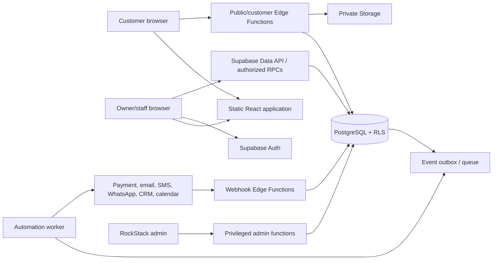

# Production Architecture

## Decision

Adopt a modular monolith built around the existing React client and one isolated Formangle Supabase project per environment. PostgreSQL is the system of record; Supabase Auth supplies workforce identity; RLS is the mandatory tenant boundary; private Storage holds media; Edge Functions or an equivalent narrow server runtime perform privileged operations, provider calls, webhook verification, public capability exchanges, and automation work.

This is a proposed architecture, not implemented infrastructure. No Supabase project, paid resource, provider account, or production data was created by this task.

## Quality attributes

Priority order for V1:

1. Tenant isolation and correct authorization.
2. Durable submissions and immutable published workflow behavior.
3. Server-authoritative validation, pricing, and lifecycle transitions.
4. Auditability and recoverability.
5. Low fixed cost and low operational complexity.
6. Replaceable provider adapters and incremental delivery.

Scale assumptions to validate before launch: fewer than 100 organizations, fewer than 100,000 submissions/year, burst traffic below 20 submissions/second, ordinary attachments below 10 MB, and Israel-first latency. These are planning assumptions, not verified forecasts.

## Logical topology

## Component responsibilities

### Existing React application

Keep:

- route and page structure;
- schema-driven `WorkflowRenderer`;
- Design Studio and Brand Kit UX;
- pure conditions, validation, pricing, transition, action, and theme engines;
- repository facade and local repository for demos/tests;
- immutable version semantics.

Change:

- add authenticated session/bootstrap state;
- replace global active-organization trust with server-provided memberships;
- implement a production client repository that calls safe table projections and RPC/Edge Function endpoints;
- never ship service/secret keys or provider credentials;
- treat server responses as authoritative and map typed domain errors to the current UI.

### Supabase Auth

- Email magic link or passwordless OTP is the recommended low-support starting method; password login can be added if business requirements demand it.
- Workforce users only: RockStack operators, business owners, and staff. Customers submitting public workflows do not need accounts.
- Invitations originate from a privileged server/admin function, create a pending organization invitation, and bind acceptance to the authenticated email/user.
- MFA is required for RockStack super-admin accounts and should be available/encouraged for business owners.
- Authorization is based on database memberships, not user-editable `user_metadata`. JWT/app metadata may be an optimization only; stale claims must never be the sole revocation control.

### PostgreSQL

- One shared schema and codebase for all businesses.
- Every tenant-owned row includes `organization_id`; composite foreign keys or triggers prevent cross-tenant references.
- RLS enabled on every exposed table and tested for `anon`, `authenticated`, staff, owner, super-admin support session, and service worker contexts.
- Mutable drafts and immutable versions are separate tables.
- JSONB stores versioned workflow configuration/design snapshots; relational columns store identity, tenant, lifecycle, query, and integrity fields.
- Critical mutations are functions/transactions: publish, submit, transition, answer action, reserve capacity, apply verified payment, and enqueue events.

### Public/customer server boundary

Do not grant anonymous direct writes to core tables. Expose narrow endpoints:

- `GET /public/workflows/:slug` returns a safe published projection and short-lived asset URLs.
- `POST /public/workflows/:slug/submissions` rate-limits, validates, recomputes price, checks capacity, inserts submission/answers, and writes outbox events atomically.
- `POST /customer/session` exchanges a raw customer token for a short-lived scoped session or performs the scoped operation directly.
- customer endpoints authorize by a hashed capability token, not by run ID.

The implementation can be Supabase Edge Functions calling transaction-safe database functions. Keep business invariants in PostgreSQL functions or a versioned shared TypeScript package so retries and alternate clients cannot bypass them.

### Storage

- Separate private buckets by purpose (`brand-assets`, `submission-files`, optional `exports`).
- Object paths start with organization ID and immutable file ID; never trust a client-supplied organization path.
- Workforce access follows organization membership; customer upload URLs are scoped to one submission token and short expiry.
- Downloads use short-lived signed URLs. Public brand assets may use a reviewed public derivative/CDN path; originals remain private.

### Integrations and automation

- Provider adapters run server-side and are selected by organization defaults plus workflow overrides.
- Provider credentials are encrypted per connection and accessible only to worker/admin server code.
- Domain transactions append an event to an outbox in the same commit.
- A queue worker claims jobs, evaluates versioned automation rules, records attempts, calls adapters with idempotency keys, and retries with bounded backoff.
- Webhooks verify signatures against the raw body, deduplicate provider event IDs, then append normalized domain events.

## Deployment topology

### Development

- Local Supabase stack through CLI for database/auth/storage/function development.
- Seeded fictional organizations only.
- Local mail capture and fake provider adapters.
- Migration reset and pgTAP/RLS tests in CI.

### Staging

- Isolated hosted Supabase project and isolated static frontend deployment.
- Synthetic/test data only; provider sandbox credentials only.
- Same migrations and functions as production.
- Required for migration rehearsal, webhook testing, load smoke tests, and restore exercises.

### Production

- Separate Supabase project, domain, keys, provider credentials, storage buckets, monitoring, and deployment approvals.
- No RAVO database, schema, credentials, backups, or network coupling.
- Deploy database expand changes before application changes; contract changes only after compatibility is verified.

For the first customer, development may begin on Supabase's no-cost tier, but commercial launch should not depend on a pausable free project or untested backup assumptions. Recheck current [Supabase pricing](https://supabase.com/pricing) and [backup capabilities](https://supabase.com/docs/guides/platform/backups) before approving spend.

## Request flows

### Owner publishes a workflow

1. Auth session is verified.
2. RLS confirms owner/admin membership for the workflow's organization.
3. Server validates draft schema and logic compatibility.
4. Transaction obtains a workflow lock, calculates the next version, inserts immutable config/design snapshot, updates the workflow's published pointer, and appends `workflow.published` plus audit records.
5. Response returns the version; UI shows success only after commit, preserving current behavior.

### Customer submits a workflow

1. Public endpoint resolves active workflow and published version by globally unique slug.
2. Rate/abuse checks and intake rules run.
3. Server parses values, discards hidden/stale answers, validates fields/consent, and recomputes pricing from the version snapshot.
4. One transaction locks relevant capacity counters, creates the submission, reserves capacity if required, assigns a reference, creates a hashed customer token, and appends an outbox event.
5. Response returns public-safe confirmation plus the raw token once. The browser stores it in the personal URL/session; logs never record it.

### Automation delivery

1. Outbox event is enqueued after commit.
2. Worker claims one job using queue visibility semantics.
3. Matching active rules are snapshotted/evaluated; each action receives a deterministic idempotency key.
4. Adapter returns a normalized result; attempt and delivery state are recorded.
5. Transient failure retries with jittered exponential backoff; terminal failure moves to a dead-letter state and alerts operations.

## Consistency and failure behavior

- Strong consistency: publication, submission validation/price, capacity, action response, payment transition, membership change.
- Eventual consistency: notifications, CRM/calendar sync, analytics projections, webhooks to customer systems.
- At-least-once job delivery with idempotent effects; do not promise exactly-once external delivery.
- Provider outage must not roll back an accepted submission. It creates a visible failed/pending delivery.
- Public reads may cache immutable published versions; workflow pointer and intake state require short TTL or revalidation.
- Apply per-organization quotas and global circuit breakers to provider calls and automation fan-out.

## Rejected alternatives

- Separate deployment/codebase per customer: rejected because it multiplies security fixes, migrations, and support cost.
- Kubernetes/microservices: rejected for V1 complexity and fixed cost; boundaries remain modular inside one backend.
- Direct anonymous inserts with permissive RLS: rejected because validation, pricing, capacity, abuse controls, and token issuance require an authoritative transaction.
- Store provider credentials in workflow JSON or browser environment: rejected because clients and exports would expose secrets.
- Immediate rewrite to Next.js or another frontend: rejected; no current requirement justifies losing the mature renderer/studio.

## Current official Supabase constraints reflected here

- RLS must be enabled on every table in an exposed schema, and role grants are separate from row policies: [Row Level Security](https://supabase.com/docs/guides/database/postgres/row-level-security).
- Views should use `security_invoker = true` on supported PostgreSQL versions or remain unexposed.
- Service/secret keys never belong in the browser; the frontend uses a publishable key with RLS.
- Private Storage access is policy-controlled and signed URLs are preferred for scoped downloads: [Storage access control](https://supabase.com/docs/guides/storage/security/access-control).
- Background work can use Supabase Queues/PGMQ and Cron, but design remains portable: [Queues](https://supabase.com/docs/guides/queues), [Cron](https://supabase.com/docs/guides/cron).

## Architecture acceptance criteria

- A diagram and table identify every public, authenticated, privileged, and provider trust boundary.
- No core table is anonymously writable.
- Cross-tenant denial is enforced and tested at the database layer.
- Every critical state change has one transaction, idempotency semantics, and an audit event.
- No provider credential, service key, raw customer token, or sensitive payload appears in frontend bundles or logs.
- Development, staging, and production are isolated and migratable from the same repository.
